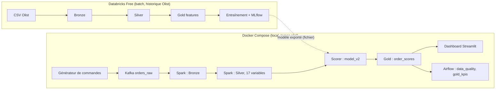

# ShopFlow Intelligence

Plateforme de données de bout en bout qui prédit le **risque de retard de livraison** de commandes e-commerce : pipeline Lakehouse (Databricks, Delta Lake), modèle suivi avec MLflow, flux temps réel (Kafka, Spark Structured Streaming), orchestration Airflow et dashboard Streamlit.


## Question métier

À partir des informations connues **au moment de la commande**, quelles commandes risquent d'être livrées après la date estimée ? Sur les données Olist, les commandes en retard obtiennent une note moyenne de **2,57** contre **4,29** pour celles livrées à l'heure (corrélation observée, pas une preuve de causalité).

## Architecture



Databricks Free ne peut pas joindre le Kafka local : le lien entre les deux mondes passe par des **fichiers exportés** (modèle `joblib`, tables de référence, coordonnées des zips).

## Stack

Databricks, PySpark, Delta Lake, MLflow, scikit-learn 1.6.1, Kafka, Spark Structured Streaming, Airflow, Streamlit, Docker Compose.

## Lancer le projet

Prérequis : Docker, 8 Go de RAM (Kafka, Spark, Airflow et le dashboard ensemble sont à la limite).

Les fichiers suivants sont ignorés par Git et doivent être exportés depuis Databricks (voir `databricks/`) :

| Fichier | Dossier |
|---|---|
| `model_v2.joblib` | `models/` |
| `ref_products.csv`, `ref_sellers.csv`, `ref_customers.csv`, `zip_coords.csv` | `data/` |

```bash
docker compose --profile gen --profile orch up -d
```

| Service | Adresse |
|---|---|
| Dashboard | http://localhost:8501 |
| Airflow | http://localhost:8080 (utilisateur `admin`, mot de passe : `docker compose exec airflow cat /opt/airflow/standalone_admin_password.txt`) |

Le générateur envoie environ **100 commandes par minute** (`--rate 1.67 --batch 1`). Pour l'arrêter : `docker compose --profile gen stop generator`. Pour repartir de zéro : `docker compose --profile gen --profile orch down && sudo rm -rf lakehouse`.

## Pipeline temps réel

1. **Générateur** (`streaming/generator.py`) : commandes brutes fictives (articles, vendeurs, produits et zips réels d'Olist), arrivées de type Poisson, mode pic.
2. **Kafka** : topic `orders_raw`.
3. **Spark Structured Streaming** (`streaming/stream_pipeline.py`) : Bronze (brut), puis Silver (explosion des articles, jointures, distance de Haversine, 17 variables). Écritures idempotentes par `MERGE`.
4. **Scorer** (`streaming/score_stream.py`) : lecture incrémentale de Silver, application du modèle, écriture de `gold_order_scores`. Le drapeau « à risque » utilise un seuil figé (80e centile des 600 premières commandes).
5. **Airflow** : `data_quality` (toutes les 15 min : doublons, retard de Gold sur Bronze) et `gold_kpis` (toutes les heures : KPI par État).
6. **Dashboard** : 4 onglets (Pipeline, Risque de retard, Qualité des données, Modèle).


