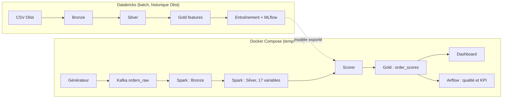

# ShopFlow Intelligence

**Plateforme Data + IA de bout en bout pour anticiper les retards de livraison e-commerce.**
Lakehouse Medallion (Databricks, Delta Lake) · Modèle suivi avec MLflow · Flux temps réel Kafka → Spark Structured Streaming · Orchestration Airflow · Dashboard Streamlit · Déploiement Docker Compose


## En bref

| | |
|---|---|
| **Problème** | Identifier tôt les commandes exposées à un retard pour que les équipes les suivent en priorité |
| **Données** | Olist (99 441 commandes, 9 tables) + flux de commandes simulées |
| **Résultat modèle** | 59 % des retards captés en surveillant 20 % des commandes (20 % au hasard) |
| **Résultat plateforme** | Flux continu sans erreur ni doublon, reprise après redémarrage sans perte |
| **Enjeu métier** | Notes moyennes de 4,29 (à l'heure) contre 2,57 (en retard) |

## Ce que le projet démontre

- **Data Engineering** : architecture Medallion, streaming Kafka → Spark → Delta, écritures idempotentes, orchestration Airflow, conteneurisation.
- **Machine Learning rigoureux** : split temporel, métriques adaptées au déséquilibre, ablations, détection de dérive de concept, aucune fuite de données.
- **MLOps** : modèle versionné dans MLflow (Unity Catalog), rechargement vérifié, transfert vers un environnement de service distinct.
- **Qualité** : tests de cohérence entre Spark et un calcul indépendant, contrôles automatiques toutes les 15 minutes.

## Architecture



Deux environnements, un seul modèle : Databricks Free ne peut pas joindre le Kafka local, donc le lien passe par des artefacts versionnés (modèle, tables de référence, coordonnées).

## Les étapes du projet

### Étape 1 : Ingestion Bronze (Databricks)
Les 9 fichiers CSV sont chargés en tables Delta avec colonnes de traçabilité. Les comptes de lignes sont contrôlés un par un (99 441 commandes, 112 650 articles, 1 000 163 lignes de géolocalisation).

### Étape 2 : Exploration et règles de qualité
96 478 commandes sont livrées, dont 96 470 exploitables (8 sans date de livraison, exclues). Taux de retard global : 8,11 %. Aucun doublon sur les clés de référence ; la géolocalisation, très dupliquée, est ramenée à une ligne par code postal.

### Étape 3 : Silver
Typage des dates (0 incohérence), agrégation des articles par commande (une ligne par commande, sans explosion de jointure), distance de Haversine client-vendeur, indicateurs de valeurs manquantes.

### Étape 4 : Gold et cible
Construction de la cible `is_late` (livraison après la date estimée) et des variables connues **à la commande**. La date de livraison réelle ne sert qu'à construire la cible. Split temporel : entraînement avant mai 2018, validation en mai 2018, test de juin à août 2018.

### Étape 5 : Modélisation
Comparaison régression logistique, Random Forest et LightGBM, évaluées par PR-AUC, ROC-AUC et capture du top 10 % et du top 20 %, pas par l'accuracy (trompeuse à 8 % de retards). Ablations : retrait de `purchase_month`, mesure du poids du délai estimé, test de la pondération des classes et de la distance.

### Étape 6 : Versionnement MLflow
Modèle enregistré dans Unity Catalog (`shopflow_late_risk`, alias `champion`), rechargé et comparé : écart de prédictions de 0,0.

### Étape 7 : Flux temps réel
Un générateur produit des commandes brutes (produits, vendeurs et zips réels d'Olist, arrivées de type Poisson, mode pic). Kafka les transporte, Spark Structured Streaming alimente Bronze puis calcule en Silver les 17 variables du modèle. Le scorer lit Silver de façon incrémentale et écrit `gold_order_scores`.

### Étape 8 : Orchestration et visualisation
Airflow exécute `data_quality` (doublons, retard de Gold sur Bronze, toutes les 15 minutes) et `gold_kpis` (KPI par État). Le dashboard suit le pipeline en direct, le risque, la qualité des données et les résultats du modèle.


## Lancer le projet

Prérequis : Docker, 8 Go de RAM. Exporter depuis Databricks : `models/model_v2.joblib` et, dans `data/`, `ref_products.csv`, `ref_sellers.csv`, `ref_customers.csv`, `zip_coords.csv`.

```bash
docker compose --profile gen --profile orch up -d
```

- Dashboard : http://localhost:8501
- Airflow : http://localhost:8080 (utilisateur `admin`, mot de passe : `docker compose exec airflow cat /opt/airflow/standalone_admin_password.txt`)

## Pistes d'évolution

Détection de dérive avec Evidently, réentraînement planifié, recalibrage du seuil par État, tests de charge Spark et scorer, variables d'historique du vendeur.

## Auteure

Nabila Chaou, élève ingénieure Big Data & IA, ENSA Tétouan.
